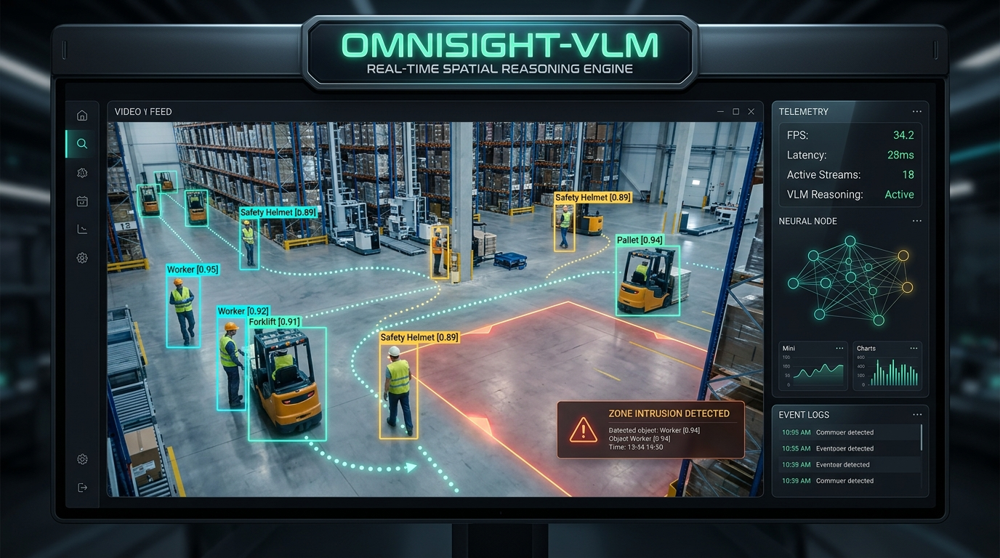

<div align="center">

# 🦅 OmniSight-VLM
### Enterprise Real-Time Open-Vocabulary Video Intelligence & Spatial Reasoning Engine

[](https://www.python.org/downloads/)
[](https://pytorch.org/)
[](https://github.com/AILab-CVC/YOLO-World)
[](https://github.com/ifzhang/ByteTrack)
[](https://opensource.org/licenses/MIT)

<br><br>



<br><br>

*An end-to-end computer vision platform bridging open-vocabulary zero-shot perception with temporal multi-object tracking, polygon spatial analytics, and asynchronous Vision-Language reasoning.*

</div>

---

## 🌟 Key Highlights

* **Zero-Shot Open-Vocabulary Perception**: Dynamically detect arbitrary entities (e.g. `"worker without helmet"`, `"forklift"`, `"cardboard box"`) in real time using **YOLO-World** text embeddings—without dataset labeling or model retraining.
* **Resilient Spatio-Temporal Tracking**: Employs **ByteTrack** two-stage Kalman association to recover tracks through severe occlusions and motion blur without ID fragmentation.
* **Spatial & Dwell Analytics**: Interactive polygon zones, tripwires, and dwell-time monitors detecting unauthorized incursions and loitering.
* **Asynchronous VLM Reasoning**: Salient spatial crops are dispatched to quantized Vision-Language Models (Qwen2-VL / Moondream2) to synthesize structured, schema-validated JSON incident reports (`Pydantic`).
* **Optimized for Edge & Low-VRAM Constraints**: Engineered with FP16/INT4 quantization and decoupled event pipelines to run at $>30\text{ FPS}$ on consumer GPUs (e.g. RTX 2050 4GB).

---

## 📐 Architecture

```
[ RTSP / Camera Stream / MP4 ]
              │
              ▼
┌───────────────────────────┐
│   Video Ingest & Decouple │  (Threaded Capture)
└─────────────┬─────────────┘
              │ (RGB Frames)
              ▼
┌───────────────────────────┐
│     YOLO-World Engine     │  (Zero-Shot Text-Prompted Detection)
└─────────────┬─────────────┘  [Prompts: "worker", "helmet", "forklift"]
              │ (Detections)
              ▼
┌───────────────────────────┐
│     ByteTrack Tracker     │  (Kalman Filter + Motion Similarity)
└─────────────┬─────────────┘
              │ (Track IDs + Trajectory History)
              ▼
┌───────────────────────────┐
│   Spatial Analytics Zone  │  (Point-in-Polygon & Dwell-Time Counters)
└─────────────┬─────────────┘
              │ (Trigger: "Zone Loiter > 5s")
              ▼
┌───────────────────────────┐
│  Asynchronous VLM Engine  │  (Quantized Vision-Language Model)
└─────────────┬─────────────┘  --> Generates Structured JSON Incident Report
              │
              ▼
┌───────────────────────────┐
│   Visualizer & HUD API    │  (Live Video + Overlay + Alerts)
└───────────────────────────┘
```

---

## 🚀 Quickstart

### 1. Installation
```bash
# Clone the repository
git clone https://github.com/waelraddaoui/OmniSight-VLM.git
cd OmniSight-VLM

# Create virtual environment
python -m venv .venv
source .venv/bin/activate  # On Windows: .\.venv\Scripts\activate

# Install dependencies
pip install -r requirements.txt
```

### 2. Generate Deterministic Synthetic Test Video
```bash
python scripts/generate_synthetic_video.py
```

### 3. Run the Real-Time Pipeline
```bash
# Run with custom open-vocabulary classes on synthetic video
python scripts/run_pipeline.py --source data/synthetic_sample.mp4 --classes "worker" "helmet" "cart"

# Run on live webcam with local VLM reasoning
python scripts/run_pipeline.py --source 0 --classes "person" "phone" "cup" --reasoning local
```

---

## 🧪 Running Unit Tests
```bash
pytest tests/ -v
```

---

## 📂 Project Structure
```text
├── configs/
│   └── default.yaml          # Model checkpoints, thresholds, zones
├── src/
│   ├── core/
│   │   └── schemas.py        # BoundingBox, Detection, TrackedObject, IncidentReport
│   ├── detector/
│   │   └── yolo_world.py     # YOLO-World open-vocabulary inference
│   ├── tracker/
│   │   └── byte_tracker.py   # ByteTrack temporal association
│   ├── analytics/
│   │   └── zone.py           # Polygon zone incursion & dwell-time logic
│   ├── reasoning/
│   │   └── vlm_engine.py     # Local VLM & Mock reasoning engines
│   ├── visualization/
│   │   └── annotator.py      # HUD, bounding boxes, motion trails
│   └── pipeline/
│       └── engine.py         # End-to-end stream orchestrator
├── scripts/
│   ├── generate_synthetic_video.py
│   └── run_pipeline.py
├── tests/
│   ├── test_schemas.py
│   └── test_analytics.py
├── requirements.txt
└── README.md
```

---

## 📜 License
Released under the [MIT License](LICENSE).
